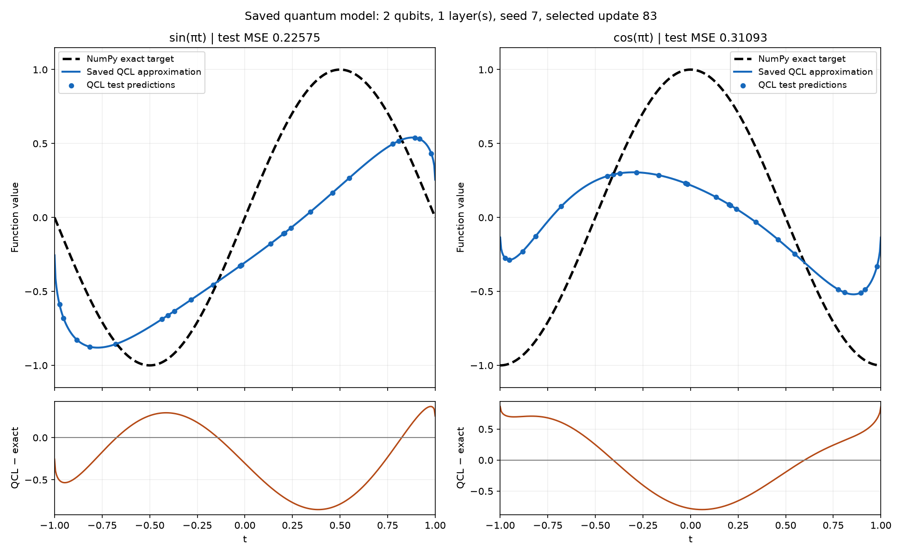

# Quantum Circuit Learning: sine and cosine

A two-qubit circuit learns **sin(πt)** and **cos(πt)** for t ∈ [-1,1]. Training uses PennyLane and PyTorch on a simulator. A small IBM hardware experiment evaluates the trained parameters on physical qubits.



## View results

With the Python environment activated:

```powershell
python view_model.py
python view_progress.py
```

The first window compares NumPy targets, simulator predictions and three saved hardware measurements. The second shows improvement across all experiment milestones and the final optimization comparison. Both are native Python windows with zoom/save controls. Add `--no-open` to save files without a window. Neither command retrains or submits hardware jobs.

## Results

Same 24 reporting inputs; lower mean squared error (MSE) is better. Checkpoints were chosen using validation, not these test scores.

| Experiment milestone | Layers | Selected update | Sine MSE | Cosine MSE |
|---|---:|---:|---:|---:|
| Initial baseline | 1 | 83 | 0.225750 | 0.310932 |
| Depth study | 3 | 250 | 0.029353 | 0.041638 |
| Five-layer fit | 5 | 1,500 | 0.001195 | 0.001506 |
| Continued training | 5 | 3,000 | 0.000751 | 0.001023 |
| Mirrored-data tuning | 5 | 4,288 | **0.000428** | **0.000596** |

[Progress graph and tables](results/progress/REPORT.md) · [All 20 experiment comparisons](results/progress/experiments.csv) · [Short progress summary](PROGRESS.md)

## Methods and efficiency

All training used **Adam**. We compared circuit depths and seeds, constant versus decaying learning rates, boundary examples, smoother input encoding, and mirrored training data with different loss weights. The selected circuit has five encoding/Rot/CNOT layers, 30 nominal angles and direct Z readouts. [Brief methodology](METHODS.md)

Batched circuit evaluation preserved predictions and gradients while reducing median CPU forward/backward time from **2.164 s to 0.0188 s** for 108 inputs: about **115×** in this five-repeat, single-thread benchmark. This is simulator implementation efficiency on this machine, not quantum advantage. [Benchmark data](results/summary/efficiency.json)

## Hardware and limits

One job on **ibm_fez**, physical qubits 143/144, measured t=-1,0,1 with 1,024 shots each. IBM reported **3 seconds** of usage. This evaluated frozen parameters; **no training occurred on hardware**. [Measured results](results/hardware/real_pilot/REPORT.md) · [Hardware tools](HARDWARE.md)

The model is approximate. Mirrored tuning improved interior errors but worsened some boundary errors; selected endpoint error is 0.049996, just below the 0.05 guard. Original-validation cosine MSE remains above the 0.001 target. Three hardware inputs do not establish full-domain device accuracy. No quantum speedup or advantage is claimed.

## Setup and verification

Python 3.12 was used for the saved experiments.

```powershell
python -m venv .venv
.\.venv\Scripts\python.exe -m pip install -r requirements.txt
```

For the complete offline audit, install the optional Qiskit tools and run:

```powershell
.\.venv\Scripts\python.exe -m pip install -r requirements-hardware.txt
.\review.ps1
```

Core checks: `python -m unittest discover -s tests -q`. Repeat the CPU timing experiment with `python -m qcl.efficiency`; it changes no model weights. Locked environments are recorded in `requirements-lock.txt` and `requirements-hardware-lock.txt`.

## Repository

| Location | Contents |
|---|---|
| `qcl/` | Quantum model, training, evaluation and audits |
| `configs/` | Reproducible experiment settings |
| `results/` | Named experiments, checkpoints, histories, figures and measured counts |
| `tests/` | Numerical, training and readout checks |

Inspired by [Mitarai et al., Quantum Circuit Learning](https://arxiv.org/abs/1803.00745); this is our own circuit study, not an exact reproduction. Credentials and private account reports are excluded from Git.
